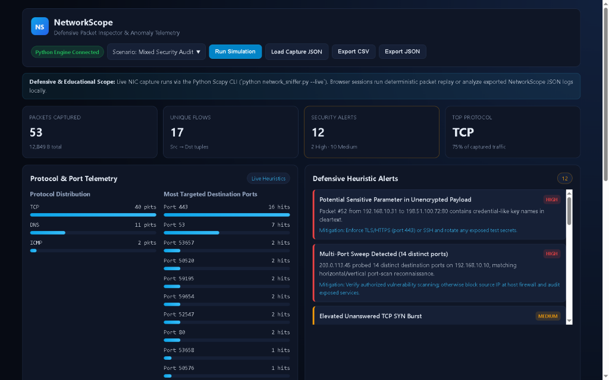

# NetworkScope (CodeAlpha Network Sniffer Upgrade)

**NetworkScope** is a Python defensive packet analysis CLI and interactive web monitoring dashboard built on top of the original `CodeAlpha_Basic_Network_Sniffer` project. It pairs Scapy-based packet capture and `.pcap` file analysis with a deterministic traffic simulator and heuristic anomaly detector.

> **Educational & Defensive Notice:** NetworkScope is designed strictly for authorized local diagnostics, defensive monitoring, and cybersecurity learning. Capture live packets only on networks and hosts you own or have explicit permission to inspect.

---

## Live Demo

- **Production URL:** [https://networkscope-web.vercel.app/](https://networkscope-web.vercel.app/)
- **Mode:** Live simulated web monitoring dashboard deployed on Vercel (Python Scapy CLI included in repo for local capture).

## Application Preview




## Key Features

- **Three Capture & Analysis Modes**
  - `--live`: Live NIC packet sniffing via Scapy (requires Npcap on Windows or `root`/`CAP_NET_RAW` on Linux/macOS).
  - `--pcap <file>`: Offline inspection of `.pcap` / `.pcapng` packet captures.
  - `--demo`: Deterministic simulated security scenarios (`mixed`, `recon`, `cleartext`, `dns_anomaly`) for safe testing without elevated privileges.
- **Defensive Heuristic Detection Engine**
  - Multi-port sweep / reconnaissance detection (`>= 8` distinct destination ports).
  - Elevated unanswered TCP SYN burst heuristic.
  - Unencrypted transport detection (HTTP/80, Telnet/23, FTP/21) and cleartext credential keyword warnings.
  - High-risk service port alerts (Telnet, SMB, RDP, VNC, port 4444).
  - Shannon entropy & long-label DNS anomaly detection.
- **Interactive Web Monitoring Dashboard (`--dashboard`)**
  - Zero-dependency Python HTTP server with JSON/CSV export endpoints (`/api/report`, `/api/simulate`, `/api/export.json`, `/api/export.csv`).
  - Client-side fallback replay & JSON log inspection mode when the `web/` directory is hosted statically (e.g., Vercel or GitHub Pages).
- **Automated Unit Tests**: `unittest` suite covering entropy scoring, port-sweep heuristics, alert generation, and CSV serialization.

---

## Tech Stack

- **Backend & CLI:** Python 3.10+, Scapy (optional for `--demo` / web UI), `http.server`, `unittest`
- **Dashboard Frontend:** Semantic HTML5, CSS3 (dark security telemetry theme), Vanilla JavaScript

---

## Project Structure

```text
CodeAlpha_Basic_Network_Sniffer/
├── networkscope/
│   ├── __init__.py
│   ├── models.py         # PacketRecord, FlowSummary, SecurityAlert dataclasses
│   ├── detector.py       # Flow aggregation & defensive heuristic rules
│   ├── sniffer.py        # Scapy live/pcap adapter + deterministic replay generator
│   └── server.py         # Local HTTP dashboard & export API
├── web/
│   ├── index.html        # Interactive NetworkScope dashboard
│   ├── styles.css
│   └── app.js            # Connects to Python API or runs standalone browser replay
├── tests/
│   └── test_networkscope.py
├── network_sniffer.py    # Main CLI entrypoint
├── requirements.txt
├── LICENSE
└── README.md
```

---

## Setup & Usage

### 1. Run Deterministic Demo + Web Dashboard (Zero External Dependencies Required)

```bash
python network_sniffer.py --demo --scenario mixed --dashboard
```

Then open `http://127.0.0.1:8765` in your browser.

### 2. Run Live Packet Capture (Requires Scapy + Packet Driver)

```bash
pip install -r requirements.txt
python network_sniffer.py --live --count 30 --dashboard
```

- **Windows:** Install [Npcap](https://npcap.com/) (with WinPcap API-compatible mode) and run terminal as Administrator.
- **Linux / macOS:** Run with `sudo` or appropriate `CAP_NET_RAW` permissions.

### 3. Analyze an Offline PCAP & Export Reports

```bash
python network_sniffer.py --pcap sample.pcap --export-json report.json --export-csv packets.csv
```

### 4. Run Automated Tests

```bash
python -m unittest discover -s tests -v
```

---

## Known Limitations

- Live sniffing requires OS-level raw socket privileges and Npcap/libpcap; environments without those drivers should use `--demo`, `--pcap`, or load exported JSON logs in the web UI.
- Heuristics are rule-based educational indicators (not a replacement for enterprise IDS/IPS such as Suricata or Zeek) and may produce false positives on legitimate high-port or CDN DNS traffic.

---

## Author

**Muzammil Shabbir** — [GitHub](https://github.com/Muzammil-s) · [LinkedIn](https://www.linkedin.com/in/muzammil-shabbir-7368a7382)
